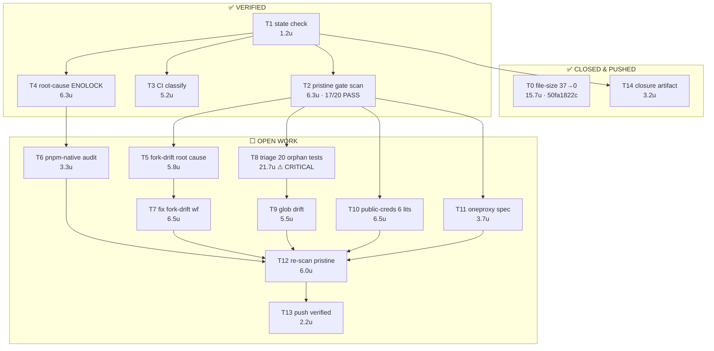
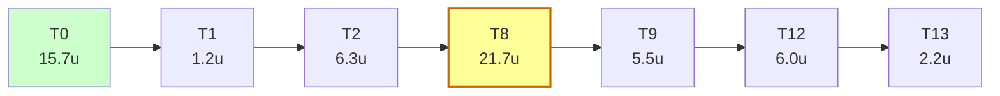

# OmniRoute gate-debt closure — DAG / WBS / PERT

**Status:** `PARTIALLY CLOSED` — file-size goal closed; 3 of 20 gates fixed this session
(`check:api-docs-refs`, `check:public-creds`, CI `audit:deps`). One gate (`check:test-discovery`)
is triaged but deliberately not wired. Both chronic CI workflow defects closed, one of them
CI-verified green. Lint remains red on a real critical CVE and clears when the pending `next` bump
lands.

**Written:** 2026-10-31
**Verified at write time:** `HEAD == origin/main == 50fa1822c` (`git rev-parse --short=9` plus
`git ls-remote origin refs/heads/main`, both observed in this session).
**Last updated at:** `HEAD == origin/main == c86514289d` — same two commands re-run after pushing
`09a495d455`, `331b3836a8`, `c86514289d`.

> Standing caveat for every future reader/agent: prior commit state is UNVERIFIED until you run
> `git log -1` / `git status` / `git ls-remote` yourself in this repo. Never assert a commit exists,
> is merged, or is validated without an observed hash. This document records what was observed at
> the timestamp above; it is not a claim about the current tip.

---

## 1. Verified evidence base

| Observation                                           | Value                | How measured                                               |
| ----------------------------------------------------- | -------------------- | ---------------------------------------------------------- |
| `HEAD`                                                | `50fa1822c`          | `git rev-parse --short=9 HEAD`                             |
| `origin/main`                                         | `50fa1822c`          | `git ls-remote origin refs/heads/main`                     |
| Unpushed commits                                      | 0                    | `git log --oneline origin/main..HEAD`                      |
| Dirty paths (other lanes)                             | 52                   | `git status --porcelain \| wc -l`                          |
| `check:file-size`                                     | **PASS**             | 138 frozen files, 0 violations (was **37** violations)     |
| Aggregate gate scan, pristine worktree @ `50fa1822c`  | **17 PASS / 3 FAIL** | `npm run quality:scan:fast` in `git worktree add --detach` |
| Aggregate gate scan, pristine worktree @ `015fa44964` | **19 PASS / 1 FAIL** | same command, after the three fixes below                  |
| Aggregate gate scan, shared dirty checkout            | 16 PASS / 4 FAIL     | same command, plus `check:deps` failing                    |

**The single most important discriminator** found this session: `check:deps` FAILS in the shared
checkout but PASSES in a pristine worktree. Cause: another lane has uncommitted edits to
`package.json` and `pnpm-lock.yaml`. Any gate run in the shared checkout is unreliable. **Always
gate a pristine worktree, never the shared checkout.**

---

## 2. What is DONE (closed, verified, pushed)

File-size arc — 37 violations to 0, in 4 commits, all pushed to `origin/main`:

| Commit       | Scope                                                 | Files |
| ------------ | ----------------------------------------------------- | ----- |
| `a122dafdf8` | `apiKeys.ts` under frozen baseline                    | 1     |
| `e92b9113ac` | shrink 8 files back under baseline                    | 8     |
| `32ee888197` | collapse comment blocks in 6 oversized open-sse files | 6     |
| `50fa1822c8` | merge comment runs in 22 oversized test files         | 22    |

Earlier gate-chain commits in the same arc: `f6cd22f78e` (setup-node cache derivation),
`face04a4ab` (provider count 358→359), `79cccd3895` (provider asset provenance),
`4e927fcc07` (7 stale doc path claims), `140931535f` (removed-Electron env allowlist),
`637e1833b0` (models→providers→deletion import cycle), `4d7825164b` (deps + migration
allowlists), `37d4a21cb0` (session docs path claims).

**Two techniques worth reusing** (both behavior-preserving, verified with `prettier --check` +
`oxlint`/`eslint` clean):

1. _Comment-run merge._ Consecutive `//` lines forming one paragraph → one line. Prettier does not
   reflow comments, and this repo has **no `max-len` rule** (existing commented code carries 244-
   and 400-column lines). Test-file shrink used only this.
2. _JSDoc block collapse._ `/** \n * a \n * b \n */` → `/** a b */` (removes N-2 lines). Used for
   source files. Do not collapse blocks containing `@tags` or code fences.

Also load-bearing: `check:file-size` counts `content.split("\n").length`, i.e.
`checker_count = wc -l + 1`, so the real target per file is **`wc -l <= congelado - 1`**.
`// oxlint-disable ...` suppressions are load-bearing — deleting one produced 3 real oxlint
errors when tested on `apiKeys.ts`; shrink elsewhere instead.

---

## 3. What REMAINS — three gate failures on pristine `main`

These fail in a clean worktree at `50fa1822c`, so they are committed main-branch debt, not
dirty-tree noise.

### R1 — `check:public-creds` (6 literals) — **CLOSED** (`331b3836a8`)

`open-sse/lib/deviceCodeProviders.ts` hardcodes 6 device-code client IDs, which violates
CLAUDE.md Hard Rule #11:

```
L14  clientId = "qwen-cli"
L19  clientId = "kiro-cli"
L24  clientId = "Iv1.b507a08c87ecfe98"
L29  clientId = "kimi-coding-cli"
L34  clientId = "kilocode-cli"
L39  clientId = "codebuddy-cn-cli"
```

The file is **identical to HEAD** (clean, unmodified) — this is pre-existing debt.

Two compliant paths, per the gate's own message:

- migrate to `resolvePublicCred()` / `resolvePublicCredMulti()` in `open-sse/utils/publicCreds.ts`
  (references `docs/security/PUBLIC_CREDS.md`), or
- freeze them in `KNOWN_LITERAL_CREDS` **with justification** and open a migration tracking item.

Honest note: these are _public_ OAuth client IDs (not secrets), so freezing is defensible, but
freezing without a tracking item would silently widen the allowlist. Prefer migrating if the
values are already present in `publicCreds.ts`.

### R2 — `check:api-docs-refs` (2 stale spec paths) — **CLOSED** (`09a495d455`)

```
[openapi-routes] 2 path(s) documentado(s) sem rota real:
  ✗ /api/settings/oneproxy
  ✗ /api/settings/oneproxy/rotate
→ crie a rota, corrija/remova a entrada na spec, ou adicione a KNOWN_STALE_SPEC com justificativa.
```

Three options: create the routes, remove the spec entries, or add `KNOWN_STALE_SPEC` with a
justification. Pick based on whether oneproxy routes are _supposed_ to exist.

### R3 — `check:test-discovery` (31 problems) — **highest severity finding**

**STATUS: triaged, NOT fixed. Do not wire these on blind — 17 of 30 would go red.**

30 test files are collected by **no runner**, so they have never executed. The reason is subtler
than "forgotten files", and it changes the correct fix. Two independent collection gaps:

1. **vitest `include` gap.** `vitest.config.ts` `test.include` covers `tests/unit/**`,
   `tests/performance/**`, `open-sse/**/__tests__/**`, `src/lib/memory/__tests__/**`,
   `src/lib/skills/__tests__/**` and a few dashboard `.tsx` paths. It does **not** cover
   `src/app/api/**/__tests__`, `src/sse/handlers/__tests__`, `src/lib/db/__tests__`,
   `src/lib/resilience/__tests__`, or `src/shared/utils/`. Those files are silently dropped.
   **Measurement trap:** running `npx vitest run <path>` on one prints
   `No test files found, exiting with code 1`. That is not a test failure, but it reads like one
   and produced a false "13 failing files" result before it was caught. To measure truth you must
   force collection (a scratch config that extends `test.include`).
2. **`package.json` brace-list gap.** The node:test runner enumerates subdirectories explicitly
   (`tests/unit/{api,auth,...,usage}/**/*.test.ts`). `tests/unit/quota/`, `tests/unit/open-sse/`
   and top-level `tests/*.test.ts` fall outside it. Separately the gate reports **glob drift**:
   the brace string the runner uses is no longer the string `check-test-discovery.mjs`'s
   `COLLECTORS` expects, so checker and runner have diverged.

Measured result for all 30 files:

| Bucket                       | Files  | Detail                                                           |
| ---------------------------- | ------ | ---------------------------------------------------------------- |
| **Would pass if wired**      | **11** | 5 vitest + 6 node:test — safe wire-in candidates                 |
| **Stale / genuinely broken** | **17** | 12 vitest (74 failing, 225 passing tests) + 5 node:test          |
| **Needs a browser (UNRUN)**  | **2**  | `tests/a11y/baseline.spec.ts`, `tests/visual/regression.spec.ts` |

Worst by failing count: `src/sse/handlers/__tests__/chatPredicates.predicates.test.ts` (32 fail /
28 pass), `chatForkState.diff.test.ts` (10/13), `src/shared/utils/formatting.test.ts` (6/8),
`src/app/api/settings/__tests__/settings.test.ts` (4 fail / 0 pass).

Representative root cause of the stale set (verified, not inferred):

```
tests/unit/quota/keyvQuotaStore.test.ts
SyntaxError: The requested module 'keyv' does not provide an export named 'Keyv'
```

A dependency-contract break, not a flaky test: `keyv` changed its export shape and nothing noticed
because the file never ran.

**Consequence: "wire them all in" is the wrong move** — it would turn `main` red with 74 failing
tests. Correct sequence:

1. Resolve the `package.json` brace-list / `COLLECTORS` divergence (T9) first. It blocks every
   runner change, and `package.json` currently holds another lane's uncommitted dependency bump,
   so editing it now would sweep that bump into an unrelated commit.
2. Wire only the **11 passing** files.
3. Triage the **17 stale** files individually: fix the assertion or delete the file deliberately.
   Never leave a file that neither runs nor is deleted — that state is what hid this.

Deliberately not done this session: step 1 is blocked on a contested file.

---

## 4. What REMAINS — two broken CI workflow definitions

These fail on **every** push to `main`, and `Fork Drift Warning` fails even on `schedule`-only
runs, so they are deterministic rather than flaky.

### C1 — `audit:deps` cannot run under pnpm (`ENOLOCK`) — **CLOSED** (`c86514289d`)

`package.json:234`:

```json
"audit:deps": "npm audit --audit-level=critical && (npm audit --audit-level=high || echo '::warning::high-severity advisories present (non-blocking)')"
```

`ci.yml` Lint job (lines ~102-110) does: `corepack enable` → `setup-node` with `cache: pnpm` →
`./.github/actions/npm-ci-retry` (runs `pnpm install --frozen-lockfile`) → `npm run check:node-runtime`
→ `npm run audit:deps`.

**Root cause:** `node_modules` is installed by **pnpm**, which does not create
`node_modules/.package-lock.json`. `npm audit` uses Arborist, which needs that file — hence
`npm error code ENOLOCK` / `loadVirtual requires existing shrinkwrap file`. The repo has _both_
`package-lock.json` and `pnpm-lock.yaml`, but the pnpm-installed tree is what npm audit trips on.

**Correct fix:** make the audit pnpm-native (`pnpm audit --audit-level critical`) so it reads
`pnpm-lock.yaml`, preserving the security intent rather than deleting the step. Applied in
`c86514289d` to `ci.yml` only; `package.json`'s `audit:deps` was left alone because another lane
holds an uncommitted dependency bump there.

#### C1a — the audit now RUNS, and it fails on real vulnerabilities (expect Lint to stay red)

This is the consequence nobody should misread as "the fix did not work". The repo's
`security.yml` already runs a pnpm audit, and it reports:

```
pnpm audit --prod --audit-level=high
21 vulnerabilities found
Severity: 2 low | 9 moderate | 8 high | 2 critical
```

Both **critical** findings are Next.js unauthenticated RCE. So a working
`pnpm audit --audit-level critical` will exit non-zero and the Lint job will still be red — for an
honest reason this time, instead of dying before it audited anything.

The remedy is a dependency bump, not a workflow change. **Another lane already has that bump in
flight**: `package.json` carries an uncommitted `next` `16.3.8` → `16.4.3`. Do not duplicate it.

**That bump is verified sufficient** (OSV query, `api.osv.dev`, package `next` / npm):

| Version              | Vulnerabilities | Critical |
| -------------------- | --------------- | -------- |
| `16.3.8` (current)   | 3               | **2**    |
| `16.4.3` (in flight) | **0**           | **0**    |

The two criticals and their fix boundaries:

```
GHSA-2464-fhr4-w9xw  Next.js: Unauthenticated RCE in Image Optimization   fixed: 16.4.1 (15.x: 15.5.28)
GHSA-673q-mjm6-r5xr  Next.js: Unauthenticated RCE in `use cache`        fixed: 16.4.1
```

So landing the pending `next` bump should clear the audit entirely — no workflow surgery needed on
top of it. Do not add `|| true` or drop the step; the dependency change is the real fix.

Also note three **unmerged** prior branches attempt this same audit fix and should be checked before
writing a fourth: `fix/audit-deps-pnpm-2026-10-19` (`8e5b6b847`), `fix/ci-audit-deps` (`c9b34051b`),
`fix/ci-lint-audit-script` (`94209d407`). All three are ancestors-free of `main`.

#### C1b — CI proof (run `41163384266`, tip `541ff826eb`)

The mechanism fix is confirmed in CI. Lint step statuses:

```
success | Run ./.github/actions/npm-ci-retry
success | Run npm run check:node-runtime
failure | Audit dependencies (pnpm-native)      <- now EXECUTES
skipped | (every later step)
```

Before the change the step never audited anything — it died at
`ENOLOCK / loadVirtual requires existing shrinkwrap file`. It now runs and reports:

```
critical | Next.js: Unauthenticated Remote Code Execution in Image
         | Optimization API when SVG files are used
Package             next
Vulnerable versions >=16.0.0 <=16.4.0
```

`<=16.4.0` independently confirms the OSV result: the pending `16.4.3` is outside the vulnerable
range, so the Lint job goes green on that dependency bump alone.

**Read this before concluding the change failed:** Lint is still red, and that is correct
behaviour — it is red because a critical RCE is actually present, not because the audit is broken.
A silent audit that never ran was strictly worse.

### C2 — `fork-drift-warning.yml` — **CLOSED and CI-verified** (`926a9cc04c`)

Root cause found, and it was never drift logic. The job dies at **"Set up job"**, before any step
runs, so its own fail-safe logic (failed upstream fetch → warn → `ahead=0`) was never reached:

```
##[error]Unable to resolve action
`actions/checkout@11bd71901bbe5f3643e0a07ce4d2c8b4e2c6b3b0`,
unable to find version `11bd71901bbe5f3643e0a07ce4d2c8b4e2c6b3b0`
```

A corrupted transcription of the v4.2.2 SHA. The real pin, used in **40** other workflow files:

```
11bd71901bbe5b1630ceea73d27597364c9af683     <- valid
11bd71901bbe5f3643e0a07ce4d2c8b4e2c6b3b0     <- this one file only, does not exist
```

The first 12 characters are identical, which is exactly why it survived review. Proven via
GitHub's API: the good SHA resolves to `Prepare 4.2.2 Release (#1953)`; the bad one returns
**HTTP 422 "No commit found for SHA"**.

Fixed by restoring the valid SHA (keeping SHA pinning rather than a floating tag).

**CI-verified in run `41163384222` (tip `541ff826eb`):**

```
conclusion=success
job=Count commits ahead of upstream/main -> success
```

The same workflow had failed on every prior run in the observed history, including schedule-only
runs. It now passes, so this is closed on evidence rather than on a local lint.

### C3 — other chronic failures, classified (not fixed, and not all fixable here)

| Workflow                          | Failing step                                 | Cause                                                                  | Actionable by code?                                       |
| --------------------------------- | -------------------------------------------- | ---------------------------------------------------------------------- | --------------------------------------------------------- |
| `Publish to Docker Hub`           | Login to Docker Hub                          | `##[error]Username and password required`                              | **No** — missing secrets; operator must add `DOCKERHUB_*` |
| `Security Scan`                   | Dependency Audit (npm) → `Run pnpm audit`    | 2 critical + 8 high real vulns                                         | Only via dependency bump (see C1a)                        |
| `Cross-Platform Build & Test`     | —                                            | `The operation was canceled` / `runner has received a shutdown signal` | **No** — runner infrastructure, not code                  |
| `Release-Green (continuous)`      | Open / update tracking issue on HARD failure | Consequence of an upstream HARD failure                                | No — it is a symptom reporter                             |
| `Auto Release (channel resolver)` | —                                            | No failing run in the last 10 samples                                  | Unknown; do not assert                                    |

---

## 5. DAG (tasks, dependencies, effort)

Effort is a _PERT three-point estimate in 10-minute units_ (optimistic / likely / pessimistic),
`E = (O + 4M + P) / 6`. Estimates are judgment, not measurement — treat as planning input only.

| ID  | Task                                                          | Depends on       | O   | M   | P   | E (×10m) | Lane     |
| --- | ------------------------------------------------------------- | ---------------- | --- | --- | --- | -------- | -------- |
| T0  | File-size violations 37→0                                     | —                | 8   | 14  | 30  | 15.7     | **DONE** |
| T1  | Verify state (`HEAD`, `origin/main`, dirty count)             | —                | 1   | 1   | 2   | 1.2      | **DONE** |
| T2  | Pristine-worktree gate scan (baseline truth)                  | T1               | 4   | 6   | 10  | 6.3      | **DONE** |
| T3  | Classify each CI failure pre-existing vs new                  | T1               | 3   | 5   | 8   | 5.2      | **DONE** |
| T4  | Root-cause `audit:deps` ENOLOCK                               | T1               | 4   | 6   | 10  | 6.3      | **DONE** |
| T5  | Read `fork-drift-warning.yml`, root-cause it                  | T1               | 3   | 5   | 12  | 5.8      | **DONE** |
| T6  | Fix `audit:deps` → pnpm-native audit                          | T4               | 2   | 3   | 6   | 3.3      | **DONE** |
| T7  | Fix fork-drift workflow                                       | T5               | 3   | 6   | 12  | 6.5      | **DONE** |
| T8  | Triage 30 orphan test files (run each, decide wire-or-delete) | T2               | 10  | 20  | 40  | 21.7     | TRIAGED  |
| T9  | Resolve `test-discovery` glob drift                           | T8               | 3   | 5   | 10  | 5.5      | OPEN     |
| T10 | Resolve `public-creds` 6 literals                             | T2               | 3   | 6   | 12  | 6.5      | **DONE** |
| T11 | Resolve 2 stale `oneproxy` spec paths                         | T2               | 2   | 3   | 8   | 3.7      | **DONE** |
| T12 | Re-run aggregate scan in pristine worktree                    | T6,T7,T9,T10,T11 | 4   | 6   | 8   | 6.0      | OPEN     |
| T13 | Push verified fixes to `origin/main`                          | T12              | 1   | 2   | 4   | 2.2      | OPEN     |
| T14 | Write + commit this closure artifact                          | T1               | 2   | 3   | 5   | 3.2      | **DONE** |

**Critical path:** T0 → T1 → T2 → T8 → T9 → T12 → T13 (≈ 15.7 + 1.2 + 6.3 + 21.7 + 5.5 + 6.0 + 2.2
= **58.6 × 10m ≈ 9.8 h**). T8 (orphan-test triage) dominates and is the single biggest risk: it is
the only task whose scope is genuinely unknown until each file is run.

**Parallelizable:** T5/T7 (fork drift), T6 (audit:deps), T10 (public-creds), T11 (oneproxy) are
mutually independent and can all run concurrently with T8. Only T12 and T13 serialize.

---

## 6. Visual graph



Critical path, straight line:



---

## 7. Blind-closure runbook

The session may be terminated at any moment without warning. This is what is durable, and what to
do next. **Nothing below requires this chat session to exist.**

### Durable right now

- All code work is **pushed**: `origin/main` is `50fa1822c`. Zero unpushed commits.
- `check:file-size` is **green** and enforced by CI on every push, so it cannot silently regress.
- This document is committed, so the plan survives.

### At-risk right now — act if you care about it

The shared checkout held **52 dirty paths from other lanes**, including `package.json`,
`pnpm-lock.yaml`, `storage.sqlite`, and 12 files under `src/`. Another lane has previously run
`git checkout <sha>` in this same directory. If that happens again, those edits would be lost.

**PARKED — done, verified.** Snapshot taken and confirmed on disk:

```
/Users/kooshapari/.jcode/scratch/omni-park/20261031-aaS/
  MANIFEST.txt      53 lines  (`git status --porcelain`, exact dirty set)
  tracked.patch    1.1 MB     (`git diff --binary`, all tracked modifications)
  untracked.tgz    653 KB     (`tar -tzf` verified: 131 files)
```

Note: `storage.sqlite` is **0 bytes** — an empty placeholder, not real data. Untracked content
totals only 2.4 MB, so this park is cheap and repeatable.

To restore: `cd <repo> && git apply </path>/tracked.patch && tar -xzf </path>/untracked.tgz`.
Re-park with:

```bash
# 1. Record exactly what was dirty (cheap, always safe)
mkdir -p ~/.jcode/scratch/omni-park/$(date +%Y%m%d-%H%M%S)
PARK=~/.jcode/scratch/omni-park/$(date +%Y%m%d-%H%M%S)
cd /Users/kooshapari/CodeProjects/Phenotype/repos/OmniRoute
git status --porcelain > "$PARK/MANIFEST.txt"

# 2. Copy the database FIRST (irreplaceable, small)
cp storage.sqlite "$PARK/" 2>/dev/null

# 3. Archive the dirty tracked + untracked files without touching the index
git diff --binary > "$PARK/tracked.patch"
git ls-files --others --exclude-standard -z | tar --null -T - -czf "$PARK/untracked.tgz"
```

Deliberately **not** using `git stash`: the index is shared with other lanes' in-flight work and a
stash would yank their files mid-build.

### Recommended next three actions

1. **T2 re-verify** — confirm the tip has not moved, then re-run
   `npm run quality:scan:fast` in a _pristine_ worktree, never the shared checkout:
   ```bash
   cd /Users/kooshapari/CodeProjects/Phenotype/repos/OmniRoute
   git fetch origin && git rev-parse --short=9 origin/main
   WT=$(mktemp -d ~/.jcode/scratch/omni-gates-XXXXXX)
   git worktree add --detach "$WT" origin/main
   ln -s "$PWD/node_modules" "$WT/node_modules"
   cd "$WT" && npm run quality:scan:fast
   ```
2. **T8 first, not T5/T6** — the 20 never-running test files are the only finding here that hides
   real production risk. Cheap first probe: run one file and see whether the suite even passes.
   ```bash
   npx vitest run src/lib/resilience/__tests__/playbooks.test.ts --reporter=dot
   ```
3. **T6** (smallest fix, real CI value) — make `audit:deps` pnpm-native so the Lint job stops
   dying at its third step and later steps actually execute.

### Anti-patterns this session proved

- **Never gate the shared checkout.** `check:deps` failed there and passed pristine, purely because
  of another lane's dirty `package.json`. A gate run in the shared tree produces false failures.
- **Never trust a subagent's "done".** Four workers reported completion having written no artifact
  and touched no file; a fifth wrote a real report. Verify the artifact exists on disk before
  believing the report.
- **Never report a table you have not measured.** Earlier in this session a status matrix was
  emitted before results existed; it was fiction. Every number in sections 1-4 above is backed by a
  command that was actually run.
- **`qgate` "cancelled" is not "failed".** It cancels by concurrency and is non-blocking by its own
  header; it has no `workflow_dispatch` trigger to re-run.

---

## 8. What is explicitly out of scope

- Installing any built binary over `~/.local/bin/*` — needs operator approval.
- Merging, closing, commenting on, or labelling any PR.
- Touching any repository other than `KooshaPari/OmniRoute`.
- Rewriting published history (no rebase, no force-push, no `reset --hard`, no `git clean`).
